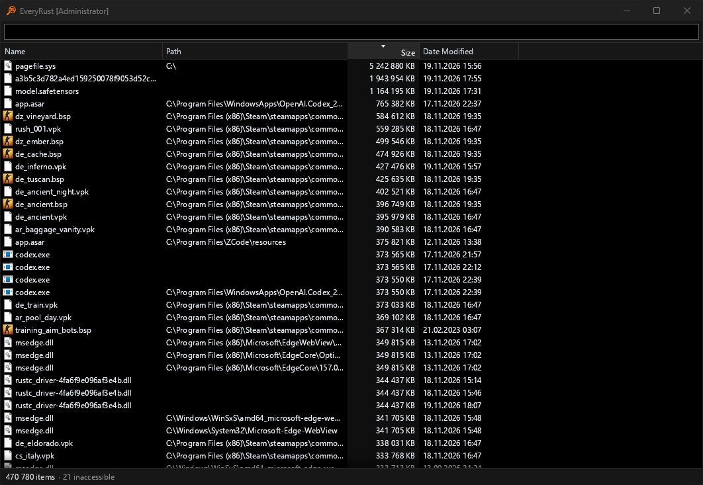

# EveryRust

[Русский](README.md) | English

Portable file and folder search for Windows x64. EveryRust indexes names,
paths, and metadata in memory, then filters results as you type. The project
includes the `everyrust-gui` desktop app, the `everyrust` command-line tool,
and the `everyrust` Rust library.



## Quick start

Download the Windows x64 archive from **Releases**, extract it, and run
`everyrust-gui.exe`. The app runs without installation.

By default, the app scans drive `C:\` and requests administrator
privileges. To scan a single folder with your current privileges, run this
PowerShell command from the folder containing the EXE:

```powershell
.\everyrust-gui.exe --no-elevate 'D:\Work'
```

Right-click the search box to open a folder or an `.efu`, `.csv`, or `.txt`
file list. The same menu contains filters, export, bookmarks, search history,
and the theme toggle. Closing the main window exits the app and stops file
monitoring. Bookmarks and search history are kept for the current session.

## Working with results

- Click a column header to sort. Results start out sorted by size, largest
  first. Drag a header divider to resize the column.
- Double-click a result to open it. Right-click for **Open Folder** or
  **Copy Path**. Click an empty area to clear the selection.
- `Ctrl+F` focuses the search box, `Ctrl+O` opens a folder, and `F5` rescans
  the current source. `Enter` opens the selected item, and `Esc` clears the search.
- `Ctrl+C` copies the selected item's full path. When text is selected in the
  search box, `Ctrl+C` copies that text instead.
- `Del` moves the selected file to the Windows Recycle Bin and removes it from the results.
- Changes to files of any size appear automatically in the indexed
  folder or drive. Press `F5` for a full rescan. Imported file
  lists are snapshots.
- The status bar shows the result count, access errors, and details about
  the selected item. The table processes rows that are fully or partially visible.

## Search queries

| Query | Matches |
|---|---|
| `report 2026` | Names containing both terms |
| `report\|invoice` | Names containing either term |
| `"report 2026"` | Names containing the phrase |
| `*.pdf`, `?oo*` | Names matching a wildcard pattern |
| `/log[0-9]+/` | Names matching a regular expression |

Search is case-insensitive by default. **Match Case**, **Match Whole Word**,
**Match Path**, and **Regular Expression** are available under **Filters**
in the search box's right-click menu.

## Command line

```powershell
$searchCli = '.\target\release\everyrust.exe'

# Search a folder
& $searchCli -root 'D:\Work' -search '*.pdf'

# Create an EFU file list
& $searchCli -create-file-list 'D:\Lists\work.efu' 'D:\Work'

# Show the ten largest PDFs in the list
& $searchCli -filelist 'D:\Lists\work.efu' -search '*.pdf' -sort size -desc -limit 10

# Print JSON or export matching paths to a text file
& $searchCli -root 'D:\Work' -search 'report' -match-path -json
& $searchCli -filelist 'D:\Lists\work.efu' -search '*.pdf' -export-txt 'results.txt'
```

The `-case`, `-whole-word`, `-match-path`, and `-regex` flags control
matching. Run `& $searchCli --help` for the full list of options.

EFU stores paths and optional size, timestamp, and attribute columns in a
UTF-8 CSV file. Relative paths are resolved from the file list's directory.

## Build and test

The build was tested on Windows x64 with Rust 1.100 and MinGW-w64
(WinLibs with UCRT). GNU builds require `gcc`, `dlltool`, and `windres`
on `PATH`. MSVC builds require Visual Studio Build Tools with C++
support and the Windows SDK.

```powershell
cargo build --locked --release
cargo test --locked --release --all-targets
```

The GUI is built as `target\release\everyrust-gui.exe` and the CLI as
`target\release\everyrust.exe`. The source icon is
[`assets/logo.ico`](assets/logo.ico). To make a portable copy, place
the GUI executable in the destination folder.

## Project layout

| File | Responsibility |
|---|---|
| [`src/scan.rs`](src/scan.rs) | Parallel directory scanning and metadata collection |
| [`src/search.rs`](src/search.rs) | In-memory index, query parsing, filtering, and sorting |
| [`src/efu.rs`](src/efu.rs) | Reading and writing file lists |
| [`src/bin/gui.rs`](src/bin/gui.rs) | Main window, virtualized results table, and file actions |
| [`src/bin/gui/live.rs`](src/bin/gui/live.rs) | File monitoring and batched index updates |
| [`src/main.rs`](src/main.rs) | Command-line interface |

The initial index is built by walking directories. Reparse points such as
junctions appear in the results, and recursive scans skip their targets.
Index coverage depends on directory access permissions.

### Benchmarks

With a warm filesystem cache, the median time to scan, index, and sort the
initial results for `C:\Windows` (212,000 entries) was 387 ms on the test PC. On an EFU list of
456,304 entries, filtering and sorting took 72 ms for `*` and 32 ms
for `*.dll`. Results vary with storage, permissions, and the dataset.

Licensed under [MIT](LICENSE).
