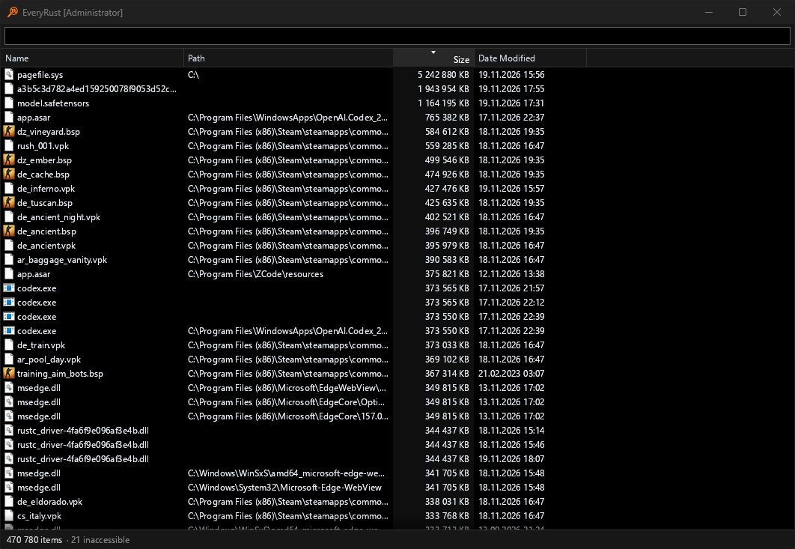

# EveryRust

Русский | [English](README.en.md)

Портативный поиск файлов и папок для Windows x64. Приложение строит индекс имён,
путей и метаданных в памяти и фильтрует результаты по мере ввода. Проект включает
графическое приложение `everyrust-gui`, командную утилиту `everyrust` и библиотеку
`everyrust`.



## Быстрый запуск

Скачайте архив Windows x64 из раздела **Releases**, распакуйте его и запустите
`everyrust-gui.exe`. Приложение запускается без установки.

По умолчанию приложение сканирует диск `C:\` и запрашивает права
администратора. Чтобы открыть одну папку с текущими правами, запустите PowerShell
из папки с EXE:

```powershell
.\everyrust-gui.exe --no-elevate 'D:\Work'
```

В графическом интерфейсе можно открыть папку или список `.efu`, `.csv` или `.txt` через
контекстное меню поля поиска. Там же находятся фильтры, экспорт, закладки, история
и переключатель темы. Закрытие главного окна завершает приложение и
наблюдение за файлами. Закладки и история хранятся до закрытия окна.

## Работа со списком

- Клик по заголовку меняет сортировку. При запуске список отсортирован по размеру от
  большего к меньшему. Перетащите границу заголовка, чтобы изменить ширину столбца.
- Двойной клик открывает файл или папку. По правому клику доступны **Open Folder**
  и **Copy Path**. Клик по пустой области списка снимает выделение.
- `Ctrl+F` переводит фокус в поиск, `Ctrl+O` открывает папку, `F5` повторно
  индексирует текущий источник. `Enter` открывает выбранный файл, `Esc` очищает поиск.
- `Ctrl+C` копирует полный путь выбранного файла. Если в поле поиска выделен текст,
  `Ctrl+C` копирует этот текст.
- `Del` отправляет выделенный файл в Корзину Windows и убирает его из результатов.
- В индексируемой папке или на индексируемом диске изменения файлов любого размера
  отражаются автоматически. Для полной переиндексации используйте `F5`.
  Импортированный список файлов служит снимком на момент его создания.
- Строка состояния показывает число результатов, ошибки доступа и сведения о
  выбранном файле. Таблица обрабатывает только полностью или частично видимые строки.

## Поисковые запросы

| Запрос | Результат |
|---|---|
| `report 2026` | Имя содержит оба слова |
| `report\|invoice` | Имя содержит хотя бы одно из слов |
| `"report 2026"` | Совпадение по фразе |
| `*.pdf`, `?oo*` | Маска для имени |
| `/log[0-9]+/` | Регулярное выражение |

По умолчанию регистр игнорируется. Параметры **Match Case**, **Match Whole Word**,
**Match Path** и **Regular Expression** доступны в меню **Filters** по правому
клику на поле поиска.

## Командная строка

```powershell
$searchCli = '.\target\release\everyrust.exe'

# Искать в папке
& $searchCli -root 'D:\Work' -search '*.pdf'

# Создать список EFU
& $searchCli -create-file-list 'D:\Lists\work.efu' 'D:\Work'

# Показать десять самых крупных PDF из списка
& $searchCli -filelist 'D:\Lists\work.efu' -search '*.pdf' -sort size -desc -limit 10

# Вывести JSON или сохранить пути в текстовый файл
& $searchCli -root 'D:\Work' -search 'report' -match-path -json
& $searchCli -filelist 'D:\Lists\work.efu' -search '*.pdf' -export-txt 'results.txt'
```

Ключи `-case`, `-whole-word`, `-match-path` и `-regex` задают режим сопоставления.
Список ключей выведет `& $searchCli --help`.

EFU хранит пути и необязательные колонки размера, времени и атрибутов в UTF-8 CSV.
Относительные пути разрешаются от папки списка.

## Сборка и проверка

Сборка проверена на Windows x64 с Rust 1.100 и MinGW-w64 (WinLibs с UCRT).
Для GNU нужны `gcc`, `dlltool` и `windres` в `PATH`. Для MSVC нужны Visual Studio
Build Tools с поддержкой C++ и Windows SDK.

```powershell
cargo build --locked --release
cargo test --locked --release --all-targets
```

Готовый GUI появится в `target\release\everyrust-gui.exe`, CLI —
в `target\release\everyrust.exe`. Исходная иконка хранится в
[`assets/logo.ico`](assets/logo.ico). Для портативной сборки достаточно скопировать
готовый GUI EXE в папку выдачи.

## Устройство проекта

| Файл | Назначение |
|---|---|
| [`src/scan.rs`](src/scan.rs) | Параллельный обход каталогов и чтение метаданных |
| [`src/mft.rs`](src/mft.rs) | Чтение главной таблицы файлов (MFT) тома NTFS |
| [`src/search.rs`](src/search.rs) | Индекс, разбор запросов, фильтрация и сортировка |
| [`src/efu.rs`](src/efu.rs) | Чтение и запись списков файлов |
| [`src/bin/gui.rs`](src/bin/gui.rs) | Окно, виртуализированная таблица и действия над файлами |
| [`src/bin/gui/live.rs`](src/bin/gui/live.rs) | Наблюдение за изменениями и обновление индекса пакетами |
| [`src/main.rs`](src/main.rs) | Командная строка |

Корень диска NTFS, например `C:\`, индексируется чтением главной таблицы файлов
(MFT) напрямую с тома, как в Everything. Для этого нужны права администратора.
Такой индекс включает файлы из папок без прав доступа. Если MFT прочитать нельзя
(нет прав администратора, диск не NTFS) или открыта обычная папка, индекс
строится параллельным обходом каталогов через `FindFirstFileExW`. Переменная
окружения `EVERYRUST_NO_MFT` отключает чтение MFT. Индекс из MFT также содержит
файлы внутри папок с точкой повторной обработки, например облачных папок OneDrive,
а обход каталогов в такие папки не заходит.

Точки повторной обработки, включая junction, отображаются как записи, а их цели
исключаются из рекурсивного обхода. При обходе каталогов на полноту индекса
влияют права доступа.

### Замеры

Замеры ниже сделаны в версии 0.2.0 обходом каталогов. На тестовом ПК с прогретым системным кэшем медианное время сканирования,
построения индекса и начальной сортировки `C:\Windows` (212 тыс. записей)
составило 387 мс. На EFU из 456 304 записей
поиск и сортировка по запросу `*` заняли 72 мс, по запросу `*.dll` — 32 мс.
Замеры зависят от диска, прав доступа и набора данных.

Лицензия — [MIT](LICENSE).
